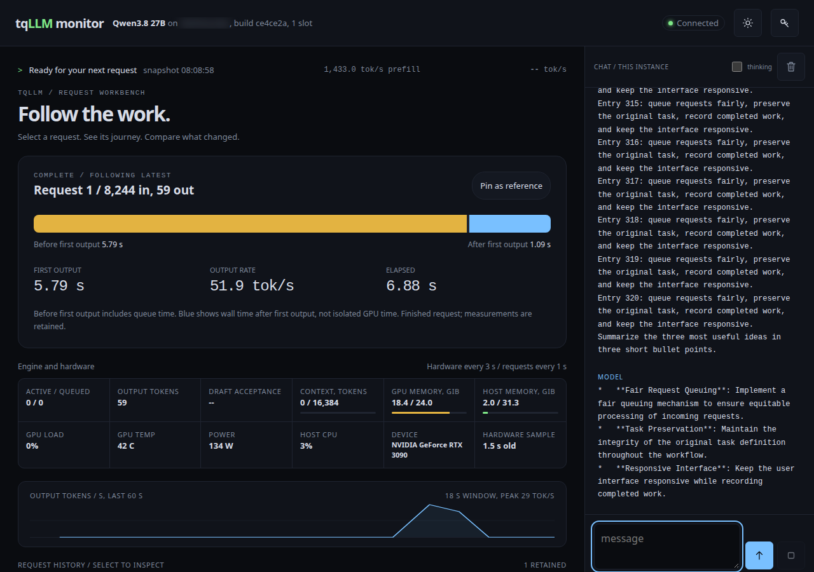
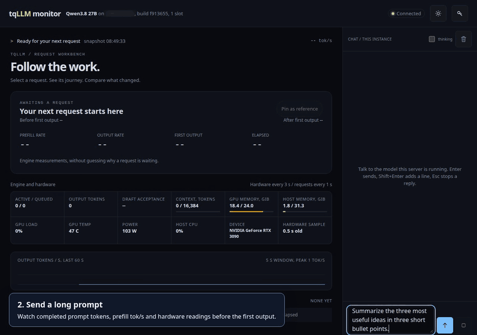

<p align="center">
  <picture>
    <source media="(prefers-color-scheme: dark)" srcset="docs/assets/tqllm-logo-dark.png">
    
  </picture>
</p>

# tqLLM

[](https://www.buymeacoffee.com/davidytan2000) [](https://gofund.me/0f79d4274)

C++/CUDA inference for supported Qwen models and TurboQuant GGUF weights,
with an OpenAI-compatible HTTP server.

[Quick start](docs/guides/quickstart.md) | [Documentation](docs/README.md) | [Benchmarks](docs/BENCHMARKS.md) | [Credits](docs/CREDITS.md)

**New: Qwen3.8-Flash-Next (125B MoE, 6B active) on one RTX 3090.** Against Strata 0.2.2 on the same card, file and
session: decode 1.63x after a 128K prompt (77.1 against 47.2 tok/s), 1.34x after 64K, first token sooner at every
length, and up to 8 users at once with the same text as one. [Details](docs/BENCHMARKS.md#qwen38-flash-next-125b-6b-active-on-one-rtx-3090).
Run it with image 1.2.3 or newer (RTX 30 or newer with 24 GB, or a GB10): [setup](https://huggingface.co/YTan2000/Qwen3.8-Flash-Next-tqLLM) (the public IQ3_S
GGUF plus a few small files; 24 GB GPU, 64 GB RAM or more).

## See what your model is doing

Watch prefill, output rates and hardware use in one view. Both rates stay in the
same request card. Open `http://localhost:8086/` or `/monitor` on the API port.
No frontend build, extra service or second port is required.



<details>
<summary>Watch the 50-second monitor walkthrough</summary>

[](docs/demos/monitor/walkthrough.mp4)

20-second preview above; [full video and step-by-step instructions](docs/demos/monitor/README.md).
Recorded with a real model. The local hostname is hidden; telemetry is unmodified.

</details>

## Run locally

Requires Linux and an NVIDIA GPU. Place a supported Qwen GGUF at
`models/model.gguf`, then build from source:

```sh
cmake -S . -B build -DCMAKE_BUILD_TYPE=Release -DCMAKE_CUDA_ARCHITECTURES=native
cmake --build build --target tqserve -j4
./build/tqserve --model models/model.gguf --port 8086
```

Open **[localhost:8086](http://localhost:8086/)** for the monitor. Applications use
the same server at `http://localhost:8086/v1`.

Prefer Docker? With the model in place, run `docker compose up --build`.
The walkthrough uses the source build; released images may predate these monitor
updates. See [installation and requirements](docs/guides/quickstart.md).

## Choose your next step

| You want to... | Read |
|---|---|
| Download a model and add a drafter | [DFlash2 and MTP](docs/guides/speculative-decoding.md) |
| Run MiniMax-M3.1-Flash or GLM-5.3-Flash on a DGX Spark / GB10 | [Big MoE models on one GB10](docs/guides/gb10-big-moe.md) |
| Run on an RTX 5090 (numbers, what is automatic) | [RTX 5090](docs/guides/rtx-5090.md) |
| Use a local coding agent | [Agent setup](docs/guides/coding-agents.md) |
| Serve several users or tune memory | [Server options](docs/reference/options.md) |
| Run a longer context | [TqCache](docs/guides/long-context.md) |
| Understand TQ3, TQ4 and compatible formats | [Weight formats](docs/reference/formats.md) |
| Inspect latency, compare requests and extend the dashboard | [Monitor guide](docs/MONITOR.md) |

## Contribute and credits

See [CONTRIBUTING.md](CONTRIBUTING.md) for building, testing and contribution
requirements, and [the architecture guide](docs/ARCHITECTURE.md) for the source map.

Built on work from Qwen, ggml/llama.cpp, Google Research, z-lab, Tom Turney,
spiritbuun, turboderp ([ExLlamaV3](https://github.com/turboderp-org/exllamav3): the trellis format and kernels behind
X3 and our EXL3 support) and the contributors listed in [Credits](docs/CREDITS.md).
Third-party notices remain in [NOTICE](NOTICE). Thank you to our community testers.

tqLLM is Apache-2.0 licensed. Model weights and third-party components retain
their own licences.
