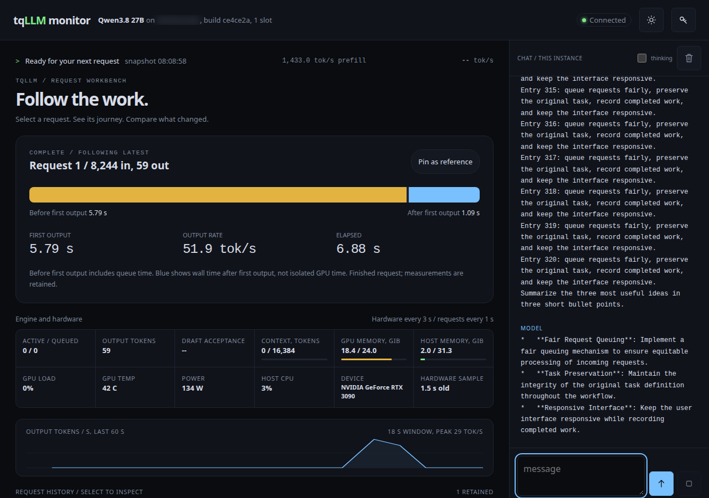
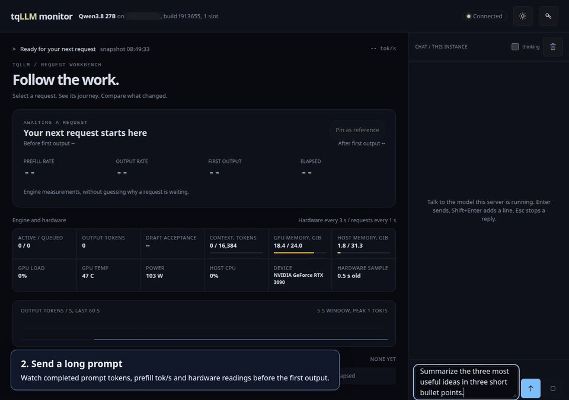

<p align="center">
  <picture>
    <source media="(prefers-color-scheme: dark)" srcset="docs/assets/tqllm-logo-dark.png">
    
  </picture>
</p>

# tqLLM

[](https://www.buymeacoffee.com/davidytan2000) [](https://gofund.me/0f79d4274)

C++ inference for supported Qwen models and TurboQuant GGUF weights on NVIDIA GPUs (CUDA) and Apple Silicon (Metal),
with an OpenAI-compatible HTTP server.

[Quick start](docs/guides/quickstart.md) | [Documentation](docs/README.md) | [Benchmarks](docs/BENCHMARKS.md) | [Credits](docs/CREDITS.md)

**New in [1.8.1](https://github.com/turbo-tan/tqllm/releases/tag/v1.8.1)** ([all changes](CHANGELOG.md)):


- **Inkling-2-Mini, raced on our own boxes with the same prompts** (Tech2Wild's `bench_inkling.py`, both engines with
  DFlash2): on one RTX 3090 against project-maya 1.1.80, counting 343.5 against 219.1 tok/s (+57 %), math +25 %, coding
  +7 %; behind by 1-6 % on json, prose, narrative and summary. On a DGX Spark against TensorFold: ahead on coding, behind
  on six of eight types by 5-16 % (next on our list). [Release notes](https://github.com/turbo-tan/tqllm/releases/tag/v1.8.1).
- **Upgrade from 1.8.0 if you serve Inkling-2-Mini on CUDA:** 1.8.0's tqserve drafted a fixed 4 tokens a step. 1.8.1 picks
  the verify window from the drafts' own confidences per step (RTX 3090 +8-23 %, DGX Spark +4-32 % over 1.8.0); drafted
  output still equals undrafted.
- **Thinking off is off:** `enable_thinking: false` opens Inkling's answer directly.
- **`pip install tqllm` on Linux** (RTX 30 / 40 / 50 and GB10, NVIDIA driver 580+; no Docker needed) and
  `pip install "tqllm[mlx]"` on Macs with macOS 26.

Flash-Next setup (RTX 30 or newer with 24 GB and 64 GB RAM, or a GB10):
[YTan2000/Qwen3.8-Flash-Next-tqLLM](https://huggingface.co/YTan2000/Qwen3.8-Flash-Next-tqLLM).
[Benchmarks](docs/BENCHMARKS.md).

## Supported models

Checked on the release build: the model loads and answers fixed questions correctly (1.7.0: Flash-Next and Inkling-2-Mini on RTX 3090 and DGX Spark / GB10, Inkling-2-Mini on an M5 Pro Mac).

| Model | Files tqLLM loads | Hardware | 1.7.0 check |
|---|---|---|---|
| Qwen3.8-27B and fine-tunes (e.g. Qwopus3.8) | TQ3_4S, TQ_L / TQ4, K-quant and IQ GGUFs; EXL3 folders; DFlash2 and MTP drafters | NVIDIA, 16 GB and up; DGX Spark / GB10 | unit tests; model check from 1.6.0 |
| Qwen3.8-27B on a Mac | mlx-community 4-bit, TQ_L, QSA files ([Mac guide](docs/guides/mac.md)) | Apple Silicon (48 GB tested) | unit tests; model check from 1.6.0 |
| Inkling-2-Mini (26B looped MoE, 3.4B active) | the official checkpoint folder (NVFP4 / MXFP8 experts, BF16 dense) | NVIDIA 24 GB and up; DGX Spark / GB10; Apple Silicon (48 GB tested) | passed (exact KLD gate on 3090, GB10, M5 Pro) |
| Qwen3.8-Flash-Next (125B MoE, 6B active) | `.tqfn` manifest over the public IQ3_S GGUF, tqLLM's own file, Unsloth Dynamic v3.1 GGUFs, NVIDIA NVFP4 experts | 24 GB GPU + 64 GB RAM; DGX Spark / GB10 | passed |
| Qwen3.5 / Qwen3.6 27B | same formats as Qwen3.8-27B (same architecture) | NVIDIA | not re-run for 1.7.0 |
| GLM-5.3-Flash, MiniMax-M3.1-Flash | GSQ GGUF; EXL3 folder ([guide](docs/guides/gb10-big-moe.md)) | one GB10, one request | not re-run for 1.7.0 |

Not verified yet: Qwen3.5 / 3.6 mixture-of-experts GGUFs (`qwen35moe`, such as Qwen3.6-35B-A3B). The MoE models
(Flash-Next, GLM-5.3-Flash, MiniMax) do not run on native Windows yet; use WSL 2 there.

### How much GPU memory it uses

Measured peak, tqLLM 1.6.0 Docker image, drafter on as shipped (DFlash2-TQ3, or the model's MTP head where marked),
reasoning on. On NVIDIA cards the memory fit fills the free VRAM up to a small margin, so long contexts show close to
the card's size; what does not fit (LM head, token embeddings, the oldest K/V) moves to system RAM, shown as host RAM.

| Card | Model file | KV | Context x users | Peak VRAM | Host RAM |
|---|---|---|---|---|---|
| RTX 3090 24 GB | `Qwen3.8-27B-TQ3_4S-v2.gguf` | bf16 | 4K x 1 | 19.5 GiB | 1.6 GiB |
| RTX 3090 24 GB | `Qwen3.8-27B-TQ3_4S-v2.gguf` | bf16 | 32K x 1 | 21.3 GiB | 1.7 GiB |
| RTX 3090 24 GB | `Qwen3.8-27B-TQ3_4S-v2.gguf` | bf16 | 64K x 1 | 23.1 GiB | 8.1 GiB |
| RTX 3090 24 GB | `Qwen3.8-27B-TQ3_4S-v2.gguf` | bf16 | 32K x 4 (`--context 131072 --np 4`) | 22.4 GiB | 12.1 GiB |
| RTX 3090 24 GB | `Qwen3.8-27B-TQ_L-QSA.gguf`, MTP, `--qsa-from 49152` | bf16 | 4K x 1 | 19.0 GiB | 2.0 GiB |
| RTX 3090 24 GB | `Qwen3.8-27B-TQ_L-QSA.gguf`, MTP, `--qsa-from 49152` | bf16 | 140K x 1 | 23.1 GiB | 12.6 GiB |
| RTX 3090 24 GB | `Qwen3.8-27B-TQ_L-QSA.gguf`, `--qsa-from 49152` | t4kv | 256K x 1 | 23.3 GiB | 8.7 GiB |
| 16 GB (RTX 3090 held to 16,203 MiB free) | `Qwen3.8-27B-TQ_XS.gguf` | tq3 | 4K x 1 | 15.1 GiB | 3.8 GiB |
| 16 GB (RTX 3090 held to 16,203 MiB free) | `Qwen3.8-27B-TQ3_4S-v2.gguf` | tq3 | 16K x 1 | 15.1 GiB | 4.2 GiB |
| 16 GB (RTX 3090 held to 16,203 MiB free) | `Qwen3.8-27B-TQ_XS.gguf` | tq3 | 200K x 1 | 14.8 GiB | 6.5 GiB |
| 16 GB (RTX 3090 held to 16,203 MiB free) | `Qwen3.8-27B-TQ_XS.gguf` | tq3 | 256K x 1 (TqCache) | 15.1 GiB | 7.1 GiB |
| 16 GB (RTX 3090 held to 16,203 MiB free) | `Qwen3.8-27B-TQ_XS.gguf` | tq3 | 32K x 4 | 15.3 GiB | 5.5 GiB |
| GB10 / DGX Spark (unified) | `Qwen3.8-27B-TQ3_4S-v2.gguf` | bf16 | 4K x 1 | 22.2 GiB total | (same memory) |
| GB10 / DGX Spark (unified) | `Qwen3.8-27B-TQ3_4S-v2.gguf` | bf16 | 128K x 1 | 30.3 GiB total | (same memory) |
| GB10 / DGX Spark (unified) | `Qwen3.8-27B-TQ3_4S-v2.gguf` | bf16 | 32K x 4 | 31.7 GiB total | (same memory) |
| GB10 / DGX Spark (unified) | Flash-Next, `flashnext.tqfn` (public IQ3_S), MTP | default | 32K x 1 | 67.7 GiB total | (same memory) |
| GB10 / DGX Spark (unified) | Flash-Next, `flashnext.tqfn` (public IQ3_S), MTP | default | 32K x 4 | 71.6 GiB total | (same memory) |

Not measured yet: a real 16 GB card (the 16 GB rows are an RTX 3090 with the rest of its memory held), 12 GB cards
and Flash-Next on a 24 GB card (both need 64 GB of system RAM; the test PC has 32 GB), and Macs.
How: `nvidia-smi` every 200 ms through load, one short chat and prompts filling about 85 % of each slot's context,
minus the idle baseline; host RAM is the drop in available system memory. On GB10 the total is that drop alone.
RTX 3090 driver 615.71.09, image `ytan2000/tqllm:1.6.0` (engine 933dc6f), 2026-11-15.

## See what your model is doing

Watch prefill, output rates and hardware use in one view. Both rates stay in the
same request card. Open `http://localhost:8086/` or `/monitor` on the API port.
No frontend build, extra service or second port is required.



<details>
<summary>Watch the 50-second monitor walkthrough</summary>

[](docs/demos/monitor/walkthrough.mp4)

20-second preview above; [full video and step-by-step instructions](docs/demos/monitor/README.md).
Recorded with a real model. The local hostname is hidden; telemetry is unmodified.

</details>

## Run locally

On a Mac (Apple Silicon, macOS 15 or newer):

```sh
curl -fsSL https://tqllm.com/install.sh | bash   # or: brew install turbo-tan/tap/tqllm
tqllm                                # starts the server in the background; the first run downloads the model and drafter
tqllm stop                           # stops it (log: ~/.cache/tqllm/server.log)
tqllm claude                         # Claude Code pointed at the local server (or: tqllm codex)
```

More in the [Mac guide](docs/guides/mac.md); on Windows see the [Windows guide](docs/guides/windows.md). The steps below are for Linux with an NVIDIA GPU. Place a supported Qwen GGUF at
`models/model.gguf`, then build from source:

```sh
cmake -S . -B build -DCMAKE_BUILD_TYPE=Release -DCMAKE_CUDA_ARCHITECTURES=native
cmake --build build --target tqserve -j4
./build/tqserve --model models/model.gguf --port 8086
```

Open **[localhost:8086](http://localhost:8086/)** for the monitor. Applications use
the same server at `http://localhost:8086/v1`.

Prefer Docker? The prebuilt image (x86-64 and arm64) runs the same server:

```sh
docker run --rm --gpus all -p 127.0.0.1:8086:8086 -v "$PWD/models:/models:ro" --entrypoint tqserve \
  ghcr.io/turbo-tan/tqllm:latest --model /models/model.gguf --host 0.0.0.0 --port 8086
```

`latest` is the newest release; use a version tag such as `1.6.0` to pin one. Or build it locally with `docker compose up --build`. See [installation and requirements](docs/guides/quickstart.md).

Two or more machines with the same model? Start a normal server on each, then point one at the others; it becomes the
single address and sends each request to the box that will answer first (and a conversation back to the box that holds it):

```sh
./build/tqserve --model models/model.gguf --np 8 --port 8086 --host 0.0.0.0                 # box 2
./build/tqserve --model models/model.gguf --np 8 --port 8086 --peer http://box2:8086         # box 1: use this one
```

## Choose your next step

| You want to... | Read |
|---|---|
| Pick the model and flags for your GPU (16 / 24 / 32 GB, GB10, measured speeds) | [Choose a setup](docs/guides/choose-your-setup.md) |
| Run on a Mac (Apple Silicon, Metal) | [Mac](docs/guides/mac.md) |
| Download a model and add a drafter | [DFlash2 and MTP](docs/guides/speculative-decoding.md) |
| Run MiniMax-M3.1-Flash or GLM-5.3-Flash on a DGX Spark / GB10 | [Big MoE models on one GB10](docs/guides/gb10-big-moe.md) |
| Run on an RTX 5090 (numbers, what is automatic) | [RTX 5090](docs/guides/rtx-5090.md) |
| Use a local coding agent | [Agent setup](docs/guides/coding-agents.md) |
| Serve several users or tune memory | [Server options](docs/reference/options.md) |
| Run a longer context | [TqCache](docs/guides/long-context.md) |
| Understand TQ3, TQ4 and compatible formats | [Weight formats](docs/reference/formats.md) |
| Inspect latency, compare requests and extend the dashboard | [Monitor guide](docs/MONITOR.md) |

## Contribute and credits

See [CONTRIBUTING.md](CONTRIBUTING.md) for building, testing and contribution
requirements, and [the architecture guide](docs/ARCHITECTURE.md) for the source map.

Built on work from Qwen, ggml/llama.cpp, Google Research, z-lab, Tom Turney,
spiritbuun, turboderp ([ExLlamaV3](https://github.com/turboderp-org/exllamav3): the trellis format and kernels behind
X3 and our EXL3 support), [@Scoobylolo](https://github.com/Scoobylolo) (the TQV-12 and TQT weight formats, their
quantisers and guides: #56, #59, #61) and the contributors listed in [Credits](docs/CREDITS.md).
Third-party notices remain in [NOTICE](NOTICE). Thank you to our community testers.

tqLLM is created by David Y. Tan and licensed under Apache-2.0: if you copy or redistribute it, keep the
[NOTICE](NOTICE) file's credit with your copy. Model weights and third-party components retain their own licences.
