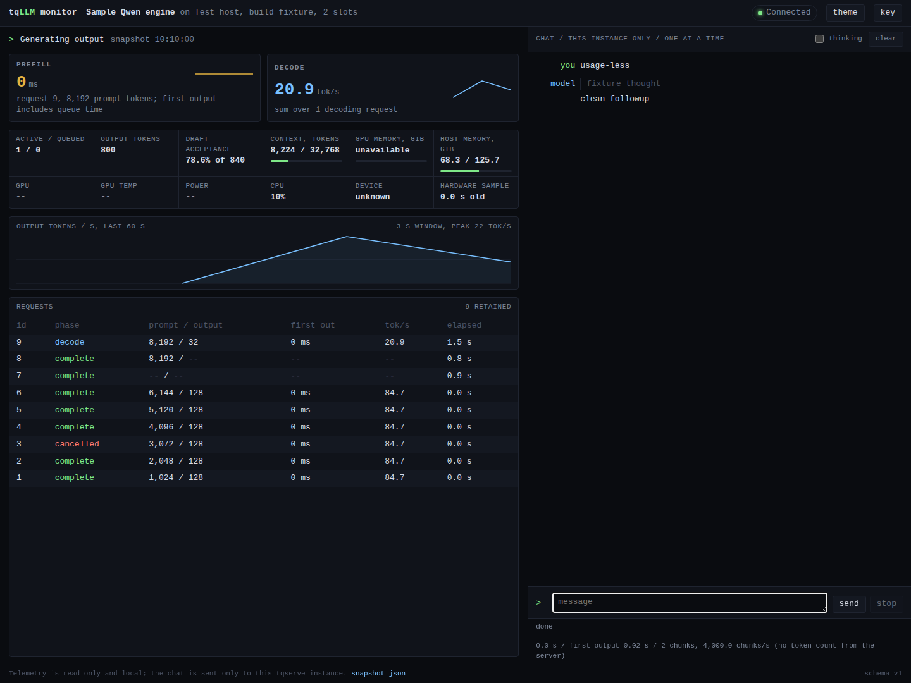
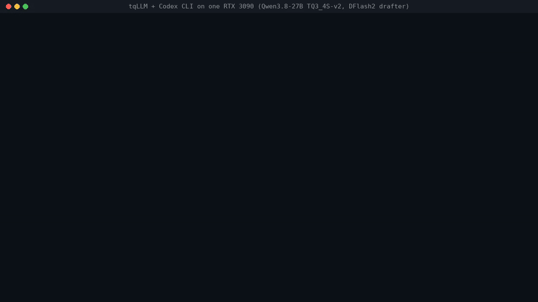

<p align="center">
  <picture>
    <source media="(prefers-color-scheme: dark)" srcset="docs/assets/tqllm-logo-dark.png">
    
  </picture>
</p>

# tqLLM

[](https://www.buymeacoffee.com/davidytan2000) [](https://gofund.me/0f79d4274)

C++/CUDA inference for supported Qwen models and TurboQuant GGUF weights,
with an OpenAI-compatible HTTP server.

## Contributing

See [CONTRIBUTING.md](CONTRIBUTING.md) for building, testing and where new models, weight formats and KV caches plug in, and
[docs/ARCHITECTURE.md](docs/ARCHITECTURE.md) for a map of the code.

## Credits

tqLLM re-implements ideas from the work below (no code unless listed in NOTICE). Reference = their idea, method or
weights; improvement = their idea, extended or re-implemented by us.

| Piece | Credit |
|---|---|
| Qwen3.8-27B weights, MTP head, chat template | Qwen team, Alibaba ([Qwen](https://huggingface.co/Qwen)) |
| GGUF format, K-quant / IQ block layouts, reference engine; base of our llama.cpp-tq3 fork | ggml authors, [llama.cpp](https://github.com/ggml-org/llama.cpp), Georgi Gerganov |
| DFlash / DFlash2 drafting method and drafter weights (served here in TQ3 / TQ4 with a 65,536-token draft vocabulary) | Jian Chen, Yesheng Liang, Zhijian Liu, [z-lab](https://github.com/z-lab/dflash) ([arXiv 2602.06036](https://arxiv.org/abs/2602.06036)) |
| Rotation-based quantisation, the lineage of the TQ3 / TQ4 weight formats and the tq3 KV cache | Google Research, [TurboQuant](https://research.google/blog/turboquant-redefining-ai-efficiency-with-extreme-compression/) |
| turbo2 / turbo3 / turbo4 KV types, REFRACT quality metric | Tom Turney (TheTom), [turboquant_plus](https://github.com/TheTom/turboquant_plus) |
| Trellis-coded KV idea (tcq codecs; codebooks and kernels ours) | spiritbuun (buun), [buun-llama-cpp](https://github.com/spiritbuun/buun-llama-cpp) |
| Learned rotations for quantisation | Avarok, TorQuant |
| Fixed chat template (v22, embedded in our files) | froggeric, [Qwen-Fixed-Chat-Templates](https://huggingface.co/froggeric/Qwen-Fixed-Chat-Templates) |
| FlashAttention tiling | Tri Dao et al., [flash-attention](https://github.com/Dao-AILab/flash-attention) |
| Speculative sampling | Leviathan, Kalman, Matias ([arXiv 2211.17192](https://arxiv.org/abs/2211.17192)); Chen et al. ([arXiv 2302.01318](https://arxiv.org/abs/2302.01318)) |
| Token-tree verification (our hybrid Gated DeltaNet tree kernels build on it) | SpecInfer, Miao et al. ([arXiv 2305.09781](https://arxiv.org/abs/2305.09781)); [Medusa](https://github.com/FasterDecoding/Medusa), Cai et al.; [EAGLE](https://github.com/SafeAILab/EAGLE), Li et al. |
| Prompt-lookup drafting (`--lookup`) | Apoorv Saxena, [prompt-lookup-decoding](https://github.com/apoorvumang/prompt-lookup-decoding) |
| Comparison baselines | [Unsloth](https://huggingface.co/unsloth) UD quants; [HyperQwen](https://github.com/syv-ai/HyperQwen); [ExLlamaV3](https://github.com/turboderp-org/exllamav3), turboderp; [vLLM](https://github.com/vllm-project/vllm); Strata, Niko1221; LocalMaxxing |

### Testers

Thank you to the testers from X who ran tqLLM on their own hardware and reported back: 0x443, Ricky Spanish,
lackonendes and GandalfOne.

## Get the image

The prebuilt image is public on the GitHub container registry and on Docker Hub. One multi-platform tag covers x86-64
(RTX 30 / 40 / 50) and arm64 (GB10 / DGX Spark); `docker pull` picks the right one.

```sh
docker pull ghcr.io/turbo-tan/tqllm:1.0.0
# or
docker pull ytan2000/tqllm:1.0.0
```

`latest` always points to the newest release.

## Docker quick start

Requires Linux, an NVIDIA GPU, Docker Compose, and NVIDIA Container Toolkit.
One image tag covers x86-64 PCs with RTX 30, 40 or 50 series GPUs (CUDA architectures 86, 89, 120) and arm64
GB10 / DGX Spark systems (121); `docker pull` picks the right platform and the engine picks its kernels for your GPU at
start. Apple Metal is not supported.

Place a supported model at `models/model.gguf` (the tokenizer is read from the GGUF). Supported: Qwen3.5 /
Qwen3.8 dense models (hybrid attention + Gated DeltaNet) and qwen35moe mixture-of-experts models such as MiniCPM-V 4.7
35B-A3B (text; `--moe-host-mb N` keeps the least-used experts in system RAM when the file is larger than the GPU), in
TQ3, TQ4, TQ3_4S, Q8_0, Q6_K, Q5_K, Q4_K, Q3_K, Q4_0, IQ4_XS, IQ4_NL, IQ3_S, IQ3_XXS, Q2_K, IQ2_S, IQ2_XS, IQ2_XXS,
IQ1_S, F16 and BF16 tensors (so Q4_K_M, Q5_K_M, Q6_K, Q8_0 and 2-bit Unsloth UD files load). IQ1_M does not load yet.

Then run:

```sh
docker compose up            # uses the prebuilt image
docker compose up --build    # or build the image from this source
```

To use an existing models directory and different filenames:

```sh
MODEL_DIR=/path/to/models MODEL_NAME=your-model.gguf docker compose up --build
```

Models are mounted read-only. The API listens at `http://localhost:8086`.
Context defaults to 16384; increase CONTEXT only when the model fits your GPU.

```sh
curl http://localhost:8086/v1/chat/completions \
  -H 'Content-Type: application/json' \
  -d '{"messages":[{"role":"user","content":"Explain a hash map."}],"temperature":0,"max_tokens":128}'
```

## Runtime monitor

Live token flow, request phases, context and host/device headroom beside a
terminal-style chat with the model on this instance. Read-only telemetry stays
responsive while single-slot inference is busy; chat supports Stop and Escape.
Build from source, add `--monitor-port 8087`, then open `http://localhost:8087/`.
See [setup, telemetry semantics and limits](docs/MONITOR.md).



## tqllm launch: a coding agent on your own GPU

`tools/launch/tqllm.py` starts a local server and runs a coding agent against it, like `ollama launch`. It needs
Python 3, Docker with the NVIDIA Container Toolkit (or a native `tqserve` build) and the agent itself installed.

```sh
python3 tools/launch/tqllm.py --list                    # model catalog (local copies are marked)
python3 tools/launch/tqllm.py launch opencode           # the default model for this GPU, downloaded if missing
python3 tools/launch/tqllm.py launch codex --model qwen3.8-27b-xs
python3 tools/launch/tqllm.py launch claude --model models/Qwen3.8-27B-TQ_S.gguf \
  --drafter models/drafters/Qwen3.8-27B-DFlash2-TQ3.gguf --draft-vocab models/mtp-vocab/atx_65536.txt
python3 tools/launch/tqllm.py serve --model qwen3.8-27b  # just the server, until Ctrl+C
```

- **Agents:** `opencode`, `codex` (through the server's OpenAI Responses API) and `claude` (Claude Code, through the
  server's Anthropic Messages API).
  `pi` (the pi coding agent) and `dsh` (DeepSeek Harness, `web` or `headless` profile) also run against the server.
  Arguments after `--` go to the agent, e.g. `launch opencode -- run "fix the failing test"`.
- **Models:** `--model` takes a GGUF file, a catalog name from `tools/launch/models.json`, or nothing (the default
  for the GPU's memory). Catalog files are looked up in `./models`, `~/models` and `$TQLLM_MODELS`; missing ones are
  offered for download from Hugging Face with a size and sha256 check (`--yes` skips the question).
- **Server:** the Docker image by default, or `--native build/tqserve`. Context defaults to 65536 because agent
  prompts are long; `--context`, `--port`, `--reasoning` and `--server-arg` (repeatable) pass through. A server already
  answering on the port is reused and left running; one the command started is stopped when the agent exits or the
  command gets Ctrl+C / SIGTERM.
- **Sampling and length:** agents get temperature 0.6, top-p 0.95 and top-k 20 for requests that set none (Qwen3.8's
  thinking-mode settings; Codex sends none, and greedy decoding can repeat itself on repetitive output such as ASCII art)
  and `--max-tokens 32768`. `--temperature 0` restores greedy decoding; `--top-p`, `--top-k` and `--max-tokens` override.
  The server takes the same defaults as `tqserve --temperature T --top-p P --top-k K`.
- The agents' own configuration files are never written; each gets its provider through its environment or command
  line.

### Codex CLI



*`tqllm launch codex` on one RTX 3090 (Qwen3.8-27B TQ3_4S-v2, DFlash2 drafter): the Codex TUI writes and runs
`fizzbuzz.py`. 47 s of server start are cut from the recording.*

Codex talks to the server's OpenAI Responses API (`/v1/responses`). `launch codex` passes the provider on Codex's
command line; arguments after `--` go to Codex:

```sh
python3 tools/launch/tqllm.py launch codex --native build/tqserve            # the Codex TUI in this directory
python3 tools/launch/tqllm.py launch codex --native build/tqserve -- exec "add a unit test for utils.py"
```

To point your own Codex at a running server instead, add this to `~/.codex/config.toml` and run `codex`:

```toml
model = "tqllm"
model_provider = "tqllm"

[model_providers.tqllm]
name = "tqLLM"
base_url = "http://localhost:8086/v1"
wire_api = "responses"
```

- Needs a server with `/v1/responses`: a [native build](#native-build) of this repository. The 1.0.0 Docker image
  predates it; the next image tag includes it.
- Codex 0.16x no longer accepts `wire_api = "chat"`. Tested with Codex 0.162.1.

## TQ formats: TQ3_4S, TQ3 and TQ4

All three rotate the weights before quantising (the TurboQuant idea: a rotation spreads outliers so a small codebook fits
every block), then store codes plus scales. They differ in block size, scales and where they run:

| Format | Block | Scales | Bits per weight | Runs in |
|---|---|---|---:|---|
| TQ3_4S (GGUF type 46) | 32 weights, 32-point rotation, 8-level code | four 8-bit scales (one per 8 weights) | 4.0 | tqLLM and [llama.cpp-tq3](https://github.com/turbo-tan/llama.cpp-tq3) |
| TQ3 (type 301) | 128 weights, 128-point rotation, 8-level code | one FP16 scale per 128 | 3.125 | tqLLM only |
| TQ4 (type 300) | 128 weights, 128-point rotation, 16-level code | one FP16 scale per 128 | 4.125 | tqLLM only |

TQ3_4S spends a quarter of its bits on scales; TQ3 and TQ4 rotate over a 4x longer block, so one scale per 128 weights
is enough and the bits go into the codes instead. That is how the 27B fits in 11.85 GB as TQ3 (TQ_XS) against 14.5 GB as
TQ3_4S-v2, and why TQ4 at about the same size as TQ3_4S is much closer to the original (KLD vs BF16 0.022 for TQ4_L).
The release files `Qwen3.8-27B-TQ_XS.gguf` (11.85 GB), `TQ_S` (12.55 GB) and `TQ4_L` (14.97 GB) are built from these
formats. Type ids 300
and 301 are tqLLM's own (above the ggml range), so these files need tqLLM; llama.cpp cannot load them.

## Fast decoding: about 250 tok/s on an RTX 3090

tqLLM speculates with a DFlash2 draft model: the drafter proposes several tokens, the 27B model checks them in one pass,
and commits the ones it would have produced itself. Greedy output is identical, token for token, to decoding without
the drafter: plain decoding and every verify (tree, chain, MTP) share one attention arithmetic, checked by
`test-tree`, `test-dflash-exact` and `test-native-mtp` and on long prompts up to 51K tokens. Download into `./models`:

| file | Hugging Face repo |
|---|---|
| `Qwen3.8-27B-TQ3_4S-v2.gguf`, the 27B model (14.5 GB) | `YTan2000/Qwen3.8-27B-TQ3_4S` |
| `drafters/Qwen3.8-27B-DFlash2-TQ3.gguf`, the DFlash2 drafter (0.79 GB) | `YTan2000/Qwen3.8-27B-TQ` |
| `mtp-vocab/atx_65536.txt`, the drafter's token list | `YTan2000/Qwen3.8-27B-TQ` |

```sh
hf download YTan2000/Qwen3.8-27B-TQ3_4S Qwen3.8-27B-TQ3_4S-v2.gguf --local-dir models
hf download YTan2000/Qwen3.8-27B-TQ drafters/Qwen3.8-27B-DFlash2-TQ3.gguf mtp-vocab/atx_65536.txt --local-dir models
```

RTX 3090, 32K context, thinking on:

```sh
docker run --rm --gpus all -p 127.0.0.1:8086:8086 -v "$PWD/models:/models:ro" \
  -e MODEL_FILE=/models/Qwen3.8-27B-TQ3_4S-v2.gguf \
  -e DRAFT_MODEL_FILE=/models/drafters/Qwen3.8-27B-DFlash2-TQ3.gguf \
  -e DRAFT_VOCAB_FILE=/models/mtp-vocab/atx_65536.txt \
  -e CONTEXT=32768 -e REASONING=on -e MAX_TOKENS=4096 \
  ghcr.io/turbo-tan/tqllm:1.0.0
```

With Compose, set the same names: `DRAFT_NAME=drafters/Qwen3.8-27B-DFlash2-TQ3.gguf
VOCAB_NAME=mtp-vocab/atx_65536.txt MODEL_NAME=Qwen3.8-27B-TQ3_4S-v2.gguf CONTEXT=32768 REASONING=on docker compose up`.

What to expect: on the LocalMaxxing reasoning prompt (32K context, 320 output tokens) an RTX 3090 runs at 240-270 tok/s
with this drafter (TQ3 and Q4_K_M builds measure the same). The server reports tok/s for every
request. Speed depends on how often the drafter's guesses are accepted, so it varies with the text: predictable text
(reasoning, prose) runs fastest, code and long contexts slower.

Long prompts: `--draft-retrieve 32` lets the drafter also read 32 far passages of the prompt (RTX 3090, 64K context:
31K / 40K / 51K-token prompts 158 / 143 / 137 -> 176 / 156 / 148 tok/s, short prompts -2 %). It keeps the drafter's
cache for the whole context (about 20 KB per token), so it is off by default.

No drafter file: `--mtp` drafts with the model's own prediction head (one user, greedy; same output as plain decoding):
155 tok/s at 1.6K and 125 tok/s at 51K tokens on an RTX 3090, against 57 and 47 without drafting.

### Recommended settings

| GPU | model | `CONTEXT` | `KV_FORMAT` | drafter | measured decode (tok/s) |
|---|---|---|---|---|---|
| RTX 3090 / 4090 (24 GB) | `Qwen3.8-27B-TQ3_4S-v2.gguf` | 32768 | default (bf16) | yes | 131-155 on summaries, 256 on LocalMaxxing |
| RTX 5060 Ti / 4060 Ti (16 GB) | `Qwen3.8-27B-TQ3_4S-v2.gguf` | 16384 | `tq3` | yes | 77-95 on summaries |
| GB10 / DGX Spark (128 GB) | `Qwen3.8-27B-TQ3_4S-v2.gguf` | 131072 or more | default (bf16) | yes | 43-54 on summaries, 79 on LocalMaxxing |

- `KV_FORMAT=tq3` stores the KV cache at about 3 bits per value instead of 16. Use it when memory is tight or the context
  is long; on 24 GB at 32K the default is fine.
- The memory fit runs at start: if `CONTEXT` does not fit, tqserve moves the token embeddings and LM head to host
  memory first, then shrinks the context, and logs each step. Pass `-fitt N` to keep N MiB of the GPU free (default
  768, 256 on WSL).
- `REASONING=on` for thinking tasks, with `MAX_TOKENS` large enough for the thinking plus the answer (4096 or more).
- `PARALLEL=N` serves N requests at once; the context is split evenly between them.

## Long context on a 16 GB card (TqCache)

Ask for more context than the GPU holds and the memory fit keeps the oldest KV positions in system RAM (exact: the
output is the same as with all KV on the GPU) instead of refusing the request. Reading that part over PCIe costs decode
speed, so use it for prompts past what the GPU holds; below that, the default context is faster.

RTX 5060 Ti 16 GB, Qwen3.8-27B-TQ_XS.gguf + DFlash2-TQ3, tq3 KV, decode tok/s. Default context: the memory fit caps the
context at 204,800 on this card and keeps all KV on the GPU. `--context 262144`: TqCache keeps the oldest positions in RAM.

| prompt | default context (204,800, all KV on the GPU) | `--context 262144` (TqCache) |
|---|---|---|
| 200K | 113 | 70 (81,920 of its positions read from RAM) |
| 224K | refused (longer than the context) | 42 |
| 248K | refused | 32 |

The fit reserves RAM for the whole requested context up front, so with `--context 262144` even a prompt that would fit
on the GPU reads part of its KV over PCIe (the 200K row). Ask for more context than the default only when the prompts
need it.

## Options

`tqserve --help` prints the same list. In Docker, the variables below set the common ones and any other option goes
after the image name (`docker run ... ghcr.io/turbo-tan/tqllm:<tag> --prefill-int8 on`).

Docker variables: `MODEL_FILE`, `TOKENIZER_FILE`, `DRAFT_MODEL_FILE`, `DRAFT_VOCAB_FILE`, `KV_FORMAT`, `CONTEXT`
(16384), `PARALLEL` (1), `MAX_TOKENS` (1024), `REASONING` (off).

### Model and serving

| Option | Default | What it does |
|---|---|---|
| `--model FILE` / `--model-dir DIR` | | the GGUF (or a safetensors directory) to serve |
| `--tokenizer FILE` | the GGUF itself | only for safetensors or a deliberate override |
| `--host IPv4`, `--port N` | 127.0.0.1, 8086 | where the API listens |
| `--context N` | 2048 | context per server, split evenly across `--np` slots; the memory fit may lower it |
| `--max-tokens N` | 16384 | default output cap per request (also the cap for requests that ask for more; thinking counts against it) |
| `--np N` | 1 | requests served at once (batched verify); `GET`/`POST /admin/slots` reads or changes the live limit |
| `--name NAME`, `--system TEXT` | | model name in the API; a default system prompt |
| `--api-key KEY` / `--api-key-file FILE` | | require a bearer key |
| `--mmproj FILE [--image-min-tokens N] [--image-max-tokens N]` | 8, 4096 | vision projector for image input |
| `--repeat-limit N` | 256 | end a request after N identical tokens in a row (0 off) |

### Reasoning and chat template

| Option | Default | What it does |
|---|---|---|
| `--reasoning on\|off` | off | thinking mode |
| `--reasoning-effort low\|medium\|xhigh` | | effort hint for the template |
| `--reasoning-budget N` (alias `--thinking-budget`) | -1 | thinking token budget (-1 unlimited, 0 end now; llama.cpp semantics) |
| `--reasoning-budget-message TEXT` | | text inserted when the budget ends the thinking |
| `--reasoning-answer-reserve N` | 8192 | tokens kept for the answer after a budgeted think (0 = budget counts inside max_tokens) |
| `--jinja` / `--no-jinja` | jinja | the model's Jinja chat template (llama.cpp's engine) or the native Qwen layout |
| `--chat-template-file FILE`, `--chat-template-kwargs JSON` | | override the template / pass template variables |

### Speculative decoding (drafter)

| Option | Default | What it does |
|---|---|---|
| `-md FILE` | | DFlash2 drafter GGUF (exact: the output equals decoding without it) |
| `--draft-vocab FILE` | | the drafter's token list (65,536 ids) |
| `--draft-max N` | 7 | drafted tokens per step (1-15); hybrid Qwen3.5 / 3.8 models verify at most 8 columns, so 7 is the effective maximum there |
| `--no-tree` | tree on | verify a single draft chain instead of a token tree |
| `--draft-window N` | GGUF value | drafter attention window over the context (0 = whole context) |
| `--lookup L [--lookup-first K]` | off | prompt-lookup drafts (copies of earlier text) next to the tree; shares the verify budget |

### KV cache and long context (TqCache)

| Option | Default | What it does |
|---|---|---|
| `--kv FORMAT` / `-ctk K -ctv V` | bf16 | KV cache format; `--list-kv` lists them (tq3 = 3-bit, trellis tcq3 / tcq2, q8, q4, splits) |
| `--kv-host N` | memory fit | KV positions kept in system RAM (exact); by default the fit moves only what does not fit on the GPU |
| `--kv-stage on\|off` | on | stream the RAM part back to the GPU layer by layer while decoding |
| `--kv-compact R [--kv-compact-at idle\|turn]` | off, idle | compress old KV R-fold (not exact; one slot, tq3 or trellis KV) |
| `--prompt-cache on\|off` | off | keep the previous turn's KV so a follow-up does not re-read the document (one slot; on with `--kv-compact`) |
| `--kv-store flat` | flat | KV storage policy (only flat is served today) |
| `--rope-scaling none\|linear\|yarn --rope-scale F [--yarn-orig-ctx N]` | none | context past the trained length (llama.cpp names) |

### Memory fit and prefill

| Option | Default | What it does |
|---|---|---|
| `-fit on\|off` | on | load, measure, and step down until the margin is free, in this order: token embeddings and the LM head to host memory, smaller prefill buffers, a smaller KV format (when `--kv` is not set), prefill weight blocks, the KV tail to system RAM, then a shorter context |
| `-fitt MiB` | 768 (256 under WSL) | free memory to leave on the GPU (64 MiB floor) |
| `-fitc N` | 4096 | smallest context the fit may choose (with `--np`: the smallest context per slot) |
| `-fitl on\|off` | on | on: when the requested context / users do not fit at full settings, pick a compact KV cache (q4/tcq2), smaller prefill buffers or weight blocks, or a shorter context, and say so at start-up (and in `/health`); off: refuse instead |
| `--gemm-rows N` | 0 (fit) | prefill FP16 weight blocks of N rows (less VRAM); the memory fit picks 2048 when needed and says so |
| `--mtp` | off | draft with the model's own MTP (nextn) head instead of `-md` (text-only, greedy, `--np 1`; default depth 4, `--draft-max N`) |
| `--draft-retrieve N` | 0 (off) | with `-md`: N far chunks of 16 positions in the drafter window; long prompts get faster (32: +8-12 % at 31K-51K on a 3090) but the drafter keeps K/V for the whole context (~20 KB / token: 1.25 GiB at 64K, 3.9 GiB at 200K), so turn it on when memory allows |
| `--mtp-from N` | 0 | with `-md` and `--mtp`: prompts of N or more tokens draft with the MTP head (`--mtp-depth D`, default 4), shorter ones with DFlash2 |
| `--slot-reserve MiB` | 128 | free memory per parallel slot after loading; an `--np` that does not fit is refused at startup with the largest that does |
| `--graph-cache N` | 256 | captured CUDA graphs kept (~12 MB each); least recently used are evicted, also when free memory runs low |
| `-ub N` | automatic | prefill chunk (ubatch) size |
| `--prefill-fp8 on\|off` | off | FP8 prefill GEMMs (sm_89+): about +40 % prefill on GB10 but KLD ~0.01 vs FP16 prefill, so opt-in; slower on 16 GB cards |
| `--prefill-int8 on\|off` | on for RTX 30 / 40 / 50 | int8 prefill GEMMs (RTX 50: +11-13 % prefill on a 5060 Ti; RTX 40 by analogy) |

### Memory fit: what it does and how to override it

You normally pass only `--context` (and `--np`). If that does not fit at full settings, the server picks what fits and
prints one line, for example:

```
tqserve: fit: to fit 1 slot(s) x 131072 in GPU memory: KV cache q4/tcq2 (asked bf16), prefill buffers -ub 512,
prefill FP16 weight blocks of 2048 rows (choose yourself with --kv, -ub, --gemm-rows or a smaller --context)
```

`GET /health` reports the same in its `fit` field. Your own settings always win; examples:

| you want | add |
|---|---|
| full-quality BF16 KV, accept a shorter context if needed | `--kv bf16` |
| a specific compact cache | `--kv q4/tcq2` (trellis V, lowest KLD of the compact caches), `--kv q8/q8`, `--kv tq3` (`--list-kv`) |
| bigger prompt buffers (faster prefill, more memory) | `-ub 2048` |
| full weight matrices for prefill (faster, more memory) | `--gemm-rows 0` |
| exactly what you asked for, or an error | `-fitl off` |
| several users at a long context (e.g. 4 x 32K) | `--np 4 --context 131072` (the context is split across `--np`) |
| keep more free memory for other programs | `-fitt 2048` (MiB left free) |

### Diagnostics

| Option / variable | What it does |
|---|---|
| `--list-kv`, `--list-flags` | KV formats; every environment flag with its status |
| `TQLLM_DEBUG=key,...` | memlog, profile, steps, stageprof, matvec, tune, prefill, draft, tree_chain, tf_dump:FILE, fakeq_k:N, fakeq_v:N |
| `TQLLM_MATVEC_RULE=BITS:KERNEL[:PF],...` | override the decode matvec kernel per format (e.g. `3:legacy:0`) |

## Performance

Measured on the model and drafter above (`Qwen3.8-27B-TQ3_4S-v2.gguf` + `Qwen3.8-27B-DFlash2-TQ3.gguf`), engine built
from the named commit, tq3 KV cache, greedy, 400 output tokens. Prompts are WikiText-2 test text cut to length with a
"summarise" instruction; each number is the median of 3 runs. tok/s is the server's own timing.

RTX 3090 24 GB, engine `de8e3c8`, context 40960:

| Prompt | Prefill tok/s | Decode, no drafter | Decode, DFlash2 drafter |
|---|---:|---:|---:|
| 2K | 2,258 | 55.5 | 155.2 |
| 8K | 2,426 | 54.5 | 149.9 |
| 32K | 2,155 | 50.6 | 131.0 |

RTX 5060 Ti 16 GB (WSL 2), engine `be4fd21`, drafter on, one run each: the memory fit chose a 16K context; 2K prompt
777 tok/s prefill / 94.5 tok/s decode, 8K prompt 821 / 76.9.

Speed with the drafter follows how often its guesses are accepted. Summaries of encyclopedia text accept about 35-40 %
of the drafted tokens; reasoning text accepts more, and the LocalMaxxing reasoning prompt runs at 256 tok/s (median of
3) on the RTX 3090 with the same files.

### Reproduce

```sh
sh bench/get_wikitext.sh                       # bench/data/wiki.test.raw (checksum-verified)
# native build: starts tqserve itself, without and with the drafter
python3 bench/relbench.py --bin build/tqserve --gpu "RTX 3090" --wiki bench/data/wiki.test.raw --out results.jsonl \
  --model v2=models/Qwen3.8-27B-TQ3_4S-v2.gguf \
  --drafter models/drafters/Qwen3.8-27B-DFlash2-TQ3.gguf --vocab models/mtp-vocab/atx_65536.txt
# or against the Docker server above (start it with -e KV_FORMAT=tq3 to match)
python3 bench/relbench.py --url http://localhost:8086 --mode dflash2 --gpu "RTX 3090" \
  --wiki bench/data/wiki.test.raw --out results.jsonl --model v2=models/Qwen3.8-27B-TQ3_4S-v2.gguf
```

Each line of `results.jsonl` records the GPU, the model file, the settings and the engine commit the server reports
(`GET /health`). A second RTX 3090 (also driving a desktop display) reproduced decode within 1 % and prefill 4-15 % lower;
prefill varies more between cards than decode.

## Tokenizer conversion

GGUF models need no tokenizer file: tqserve reads it from the GGUF metadata. Only safetensors checkpoints, or a
deliberate override (`--tokenizer FILE`), need a tokenizer.tqtok. Build it from tokenizer.json and
tokenizer_config.json of the SAME original model family/version. Conversion needs Python 3, not PyTorch:

```sh
python3 tools/tqconvert.py --source /path/to/hf-tokenizer --out-dir models --tokenizer-only
```

## Native build

```sh
cmake -S . -B build -DCMAKE_BUILD_TYPE=Release -DCMAKE_CUDA_ARCHITECTURES=native
cmake --build build --target tqserve -j4
./build/tqserve --model models/model.gguf --port 8086
```

Needs CMake 3.25 or newer (CUDA C++20; `python3 -m pip install cmake` gets one on older distributions) and a recent
CUDA toolkit; CUDA 12.9 and 13.0 were tested on RTX 3090.
Model downloads are not included. Model weights and bundled third-party source
retain their own licenses. tqLLM itself is licensed under Apache-2.0 (see LICENSE and NOTICE).

### Request sampling numbers

`top_k` accepts integers from 0 to INT_MAX; sampling currently uses at most 16 candidates.
`seed` accepts integers from 0 to 9007199254740991 (the JSON parser's exact integer range).
Negative seeds are rejected with HTTP 400; omitted, null or zero retains the default seed behavior.
Fractional, out-of-range and nonnumeric values are rejected before integer conversion.

## Target-head shortlist

The default greedy verifier ranks the full vocabulary with a 4-bit head, then re-scores its top 16 candidates with
an int8 head. The re-score is exact for those candidates; an omitted vocabulary row can still win the full int8
projection. This is an empirical speed optimisation, not a certified full-vocabulary argmax. A large shortlist
margin alone does not bound the scores of omitted rows.

For full-vocabulary verification and logit diagnostics, the C++ API provides `Model::set_full_logits(true)`.
Set it before the first forward or verify call on a fresh model: existing CUDA graphs retain the head path captured
when they were created. The reference is the runtime's converted int8 head, not the original GGUF head tensor.
Some wider single-slot verify calls already use that full int8 path; a width sweep must record the path exercised.
